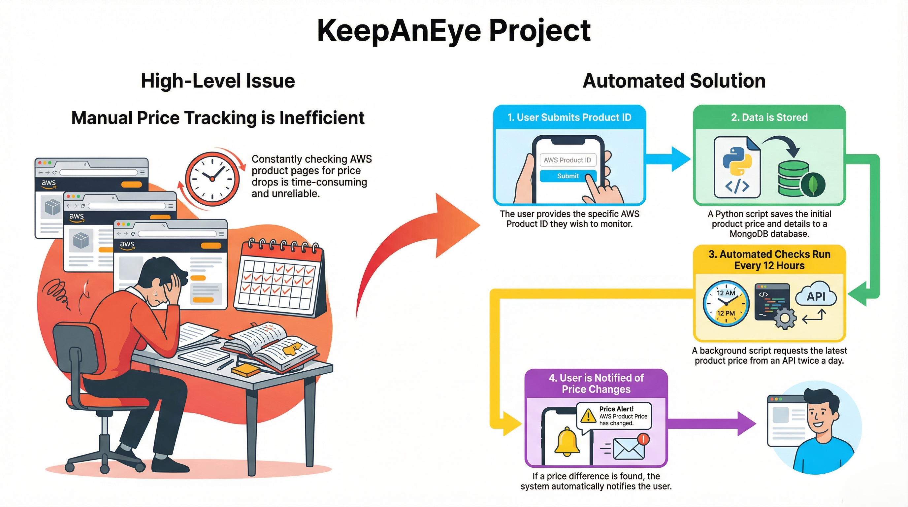
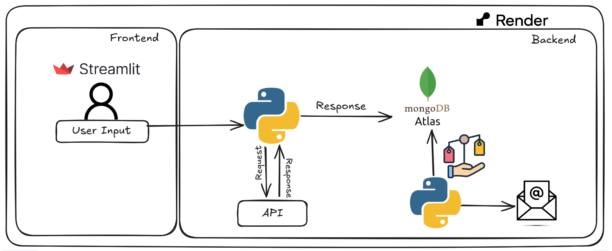

# 👁️ KeepAnyEye - Amazon Price Drop Tracker

<div align="center">
  
  ### Never Miss a Deal Again!
  
  [](https://www.python.org/downloads/)
  [](https://streamlit.io/)
  [](https://www.mongodb.com/)

</div>

---

## 🎯 The Problem

Tired of **bookmarking Amazon product pages** and manually checking prices every day? 

Missing out on deals because you forget to check? Frustrated by fluctuating prices and not knowing when to buy?

**KeepAnyEye solves this!** 

Simply enter a product's ASIN and your email—App will monitor the price 24/7 and alert you the moment it drops. No more manual checking. No more missed opportunities. Just smart, automated price tracking.

---

## ✨ Features

- 🔍 **Automatic Price Monitoring** - Checks prices every 12 hours.
- 📧 **Instant Email Alerts** - Beautiful HTML emails when prices drop.
- 🎨 **Clean Web Interface** - Simple, intuitive Streamlit UI.
- 💾 **MongoDB Storage** - Reliable data persistence.
- 🔄 **Background Processing** - Runs continuously without user intervention
- 📊 **Price History** - Track price changes over time
---

## 🎥 Demo

### **How It Works**


https://github.com/user-attachments/assets/85546516-662d-48ab-8547-fdd6843b1a4a


---

## 🏗️ Architecture

### **High-Level Architecture**



### **Technical Architecture**



---

## 📋 Usage

### **Tracking a Product**

1. Find the **ASIN** of the Amazon product you want to track.
   - Look in the product URL: `amazon.com/dp/B0D11HXZNR`.
   - Or check the "Product Information" section.

2. Enter the **ASIN** and your **email** in the web interface.

3. Click **"Start Tracking"**

4. You'll receive an email notification whenever the price drops!

### **Finding Amazon ASIN**

**Method 1: From URL**
```
https://www.amazon.com/dp/B0D11HXZNR
                         ^^^^^^^^^^
                         This is the ASIN
```

**Method 2: Product Details**
- Scroll to "Product Information" section
- Look for "ASIN: B0D11HXZNR"

---

## 🛠️ Technology Stack

| Component | Technology | Purpose |
|-----------|-----------|---------|
| **Frontend** | Streamlit | Web interface |
| **Backend** | Python 3.8+ | Core logic |
| **Database** | MongoDB | Data storage |
| **API** | SerpAPI | Amazon product data |
| **Email** | SMTP (Gmail) | Notifications |
| **Scheduling** | Threading | Background tasks |
| **Deployment** | Render | Cloud hosting |

---

## 📁 Project Structure

```
keepanyeye/
│
├── app.py                      # Main Streamlit application
├── main.py                     # CLI version (optional)
│
├── keepaneye/                  # Core package
│   ├── __init__.py
│   ├── api_call.py            # API integration
│   ├── save_to_db.py          # Database operations
│   ├── price_monitor.py       # Price comparison logic
│   ├── notify_user.py         # Email notifications
│   ├── tracking_manager.py    # Subscription management
│   ├── read_creds.py          # Configuration loader
│   └── user_input.py          # Input validation
│
├── .streamlit/                 # Streamlit configuration
│   └── config.toml
│
├── .env                        # Environment variables (create this)
├── .gitignore
├── requirements.txt
├── Procfile                    # For Render deployment
├── README.md
├── LICENSE
```
---

## 🐛 Known Issues & Limitations

- **Rate Limits**: SerpAPI has request limits (250 free searches/month)
- **12-Hour Delay**: Price checks happen every 12 hours (configurable)
- **Email Delays**: SMTP servers may have sending delays
- **Amazon Blocks**: Amazon may block frequent automated requests
---

### **Workarounds**

- Use a paid SerpAPI plan for more requests
- Adjust check frequency in `run_price_checker()` function
- Use multiple email accounts for higher sending limits

---

## 📝 Roadmap

- [ ] Add AWS Services such as AWS Lambda,AWS Event Bridge and other Serivices.
- [ ] Add support for multiple Amazon regions (UK, DE, JP, etc.)
- [ ] Support for other e-commerce sites (eBay, Walmart)
- [ ] Wishlist management

---
